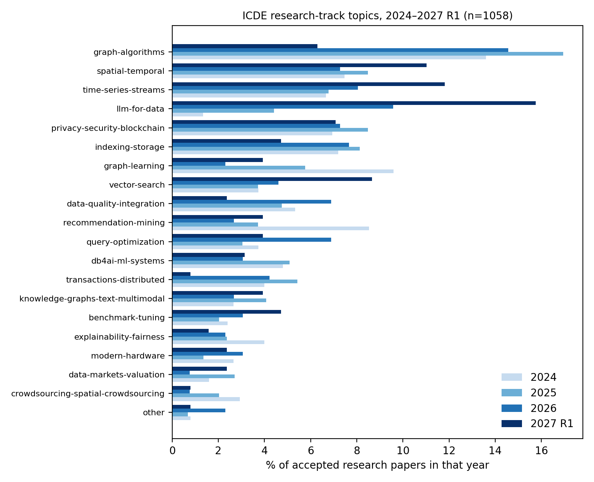
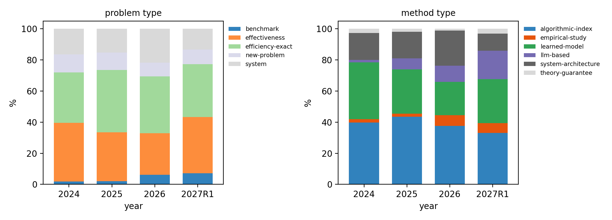

# 02 ICDE 2024–2027R1 录用论文方向调研与分类

## 1. 数据与方法
- **样本**：官方录用列表全量解析，共 **1058 篇 research track 论文**：ICDE 2024（375 篇，来自 icde2024.github.io/papers.html）、ICDE 2025（295 篇，ieee-icde.org/2025/research-papers/）、ICDE 2026（261 篇，icde2026.github.io/accepted-papers.html）、ICDE 2027 第一轮（127 篇，icde2027.github.io/accepted-papers.html）。
- **摘要**：通过 OpenAlex（ICDE 源 S4210210321）按标题匹配到 761 篇摘要（2024: 371，2025: 291，2026: 99；2027R1 尚未出版，仅标题）。DBLP 有反爬验证，未使用。
- **分类**：DeepSeek-chat（temperature 0）按 20 类主题 × 5 类问题 × 6 类方法 进行标注（脚本 `classify.py`，结果 `accepted_all.json`）。这是自动标注，个别论文可能归类有偏差，但趋势稳健。
- **页数**：IEEE Xplore 页码显示已出版论文中位数 **14 页**（12 页正文 + 约 2 页参考文献），576/912 篇恰好 14 页——审稿版基本都写满 12 页。

## 2. 研究领域排名（四年合计，及各年占比）

| 排名 | 领域 | 合计 | 2024 | 2025 | 2026 | 2027R1 | 趋势 |
|---|---|---|---|---|---|---|---|
| 1 | 图算法（稠密子图、路径、匹配、社区、中心性、图查询） | 147 | 13.6% | 16.9% | 14.6% | 6.3% | 体量最大，稳定 |
| 2 | 时空数据（轨迹、路网、POI、城市） | 86 | 7.5% | 8.5% | 7.3% | 11.0% | 稳中有升 |
| 3 | 时间序列与流（预测、异常检测、流系统） | 81 | 6.7% | 6.8% | 8.0% | 11.8% | 上升 |
| 4 | 隐私/安全/区块链 | 79 | 6.9% | 8.5% | 7.3% | 7.1% | 稳定 |
| 5 | 索引与存储（学习型索引、KV、LSM、压缩） | 77 | 7.2% | 8.1% | 7.7% | 4.7% | 稳定 |
| 6 | 图学习（GNN） | 64 | 9.6% | 5.8% | 2.3% | 3.9% | **下降** |
| 7 | **LLM for Data**（Text-to-SQL、LLM 数据处理、RAG、表格问答、LLM 做 DB 调优） | 63 | 1.3% | 4.4% | 9.6% | **15.7%** | **增长最快，2027R1 第一** |
| 8 | 数据质量与集成（清洗、插补、实体解析、数据发现） | 55 | 5.3% | 4.7% | 6.9% | 2.4% | 稳定 |
| 9 | 推荐与挖掘 | 55 | 8.5% | 3.7% | 2.7% | 3.9% | **下降** |
| 10 | **向量检索**（ANN、过滤 ANN、多向量） | 48 | 3.7% | 3.7% | 4.6% | **8.7%** | **快速上升** |
| 11 | 查询优化（基数/代价估计、优化器） | 46 | 3.7% | 3.1% | 6.9% | 3.9% | 稳定 |
| 12 | DB4AI / ML 系统 | 45 | 4.8% | 5.1% | 3.1% | 3.1% | 略降 |
| 13 | 事务/分布式/云数据库 | 43 | 4.0% | 5.4% | 4.2% | 0.8% | 稳定 |
| 14 | 基准/调优/测试 | 29 | 2.4% | 2.0% | 3.1% | 4.7% | 上升 |

其余：知识图谱与多模态（34）、可解释与公平（30）、新硬件（25）、众包（20，下降）、数据定价与估值（19）。

## 3. 问题类型与方法类型

- **问题类型**：效率型（已定义问题做快/可扩展）约 33–40%，效果型约 27–38%，系统型 13–22%，新问题定义约 9–12%，**基准/实验研究从 2% 涨到 6–7%**（EAB 类别在 2026 年起大量出现：2026 年 14 篇、2027R1 4 篇）。
- **方法类型**：算法+索引（带复杂度分析）始终是第一大类（33–43%）；纯学习模型从 36.5% 降到 21–28%；**以 LLM 为核心的方法从 1.6% 升到 18.1%**。
- 涉及 LLM 的论文数：6 → 24 → 37 → 28（2027R1 仅半年就占 22%）。
- 约 1/4 的论文面向动态/流式/更新场景（"Maintaining … in Dynamic Graphs" 是一种稳定的选题模板）。

## 4. 各领域内部"偏好的科学问题"（由标题+摘要归纳）

**(1) 图算法**：几乎 90% 是"算法+索引"型。科学问题集中在：
- 已有静态定义的结构（k-core、truss、quasi-clique、Leiden 社区、ego-betweenness、最短路）在**动态图/十亿规模**下的增量维护；
- 新的稠密子图/社区定义（加约束：时序、属性、公平、二部图）及其 NP-hard 性 + 精确/近似算法；
- 典型证据：复杂度定理 + 在 SNAP/LAW 十余个真实图上 1–3 个数量级加速。

**(2) LLM for Data**（增长最快）：
- Text-to-SQL：schema linking、候选生成后的**选择/验证**（"Beyond Majority Voting"、CYANSQL 测试时扩展、无标注评估器）；
- **成本感知的 LLM 数据处理**：SPARQ（自适应路由的表格问答）、CARROT（代价约束 RAG 检索优化）、BOND（LLM 分析与关系数据协同设计）、EPAS（异步调度 LLM 日志解析）；
- LLM 做 DB 任务：索引顾问（LLMIA、AMAZe）、分区（HERA）、knob tuning（Rabbit）；
- RAG 作为数据系统问题：检索精度、图式 RAG 索引、边云协同。
- 共同点：把"调 LLM"重新表述为**带预算/准确率约束的优化问题**，强调 token/美元成本与延迟。

**(3) 向量检索**：过滤 ANN（标签、范围、多属性）、动态索引维护、多向量检索、磁盘/GPU 索引、距离计算加速；基本是"索引+剪枝+理论/经验界"。

**(4) 时间序列与流**：预测、异常检测、插补；近两年出现**鲁棒性基准**（TS-Fault EAB）。

**(5) 时空数据**：轨迹相似、轨迹-用户链接、路网查询、时空预测。

## 5. 对选题的结论
1. **LLM for Data 是当前最"热"且增速最快的方向**（2027R1 占 15.7%，排第一），同时与我们拥有的资源（DeepSeek/GLM/Kimi API）最匹配——实验不需要 GPU，可在几天内完成真实实验。
2. 该方向被录取论文的共同"数据工程化"写法：把 LLM 调用当成昂贵的、不可靠的算子，研究**代价、正确性保证、调度/路由/选择**等经典 DB 问题——这正是 ICDE 认为"in scope"的关键（CFP 明确排除纯 ML）。
3. 图算法是体量最大的稳定方向，但需要深厚的算法积累与大规模图实验，8 天内难以做出有竞争力的新结果；作为备选。
4. EAB 类别正在扩张，但要求 "fundamentally new insight" + 全部复现材料。

后续第 3 阶段将对 LLM for Data（两组）、向量检索+EAB、图算法+时间序列 共约 20 篇论文做全文深读。
